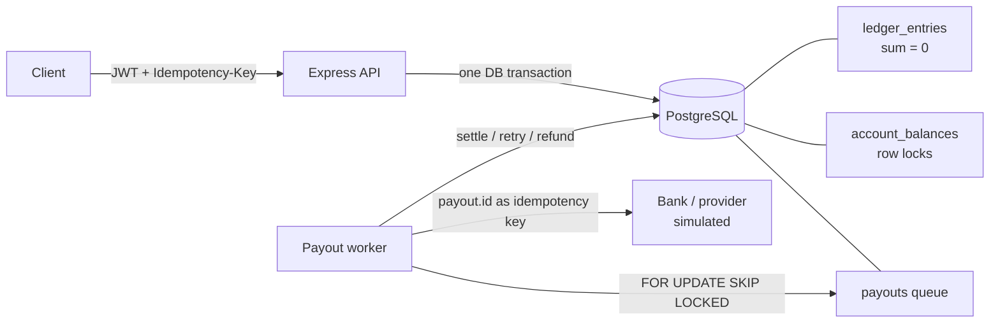

# payroll-ledger-api

A small payout ledger API in **Node.js, TypeScript and PostgreSQL**, built to practise the hard parts of moving money:
**idempotent requests, concurrency-safe balances, a double-entry ledger and a queue-based payout worker with retries**.

It is a personal learning project, not a production system. Everything described below is implemented and covered by tests.

## What it does

- Customers have accounts; money arrives by **deposit**, moves by **transfer** and leaves by **payout**.
- Every money movement is a **double-entry transaction**: its ledger entries always sum to zero.
- Write endpoints require an **`Idempotency-Key`** header, so a client can retry safely after a timeout.
- Payouts are **held** immediately, then processed by a **worker** that calls a (simulated) bank and retries with backoff.



## How the hard parts are handled

**Idempotency** (`src/lib/idempotency.ts`)
- The key row is inserted **in the same database transaction** as the money movement, and the response is stored before commit.
- A concurrent request with the same key **blocks on the unique index** until the first one commits, then returns the stored response (`Idempotent-Replayed: true`). No double spend, no "in progress" state to clean up.
- Same key with a different body or endpoint: `422 idempotency_key_reused`.
- Business errors (e.g. `422 insufficient_funds`) are stored too, so a retry gets the same answer. Unexpected errors roll back everything, including the key.

**Concurrency** (`src/lib/ledger.ts`)
- Balances live in `account_balances` and are locked with `SELECT ... FOR UPDATE` inside the transaction.
- Rows are always locked **in account-id order**, so opposite transfers (A→B and B→A) cannot deadlock.
- Customer balances can never go negative; system accounts (treasury, payout clearing, payout sink) can.
- Amounts are integers in minor units (`BIGINT`, handled as `bigint` in TypeScript) to avoid floating-point errors.

**Payout queue** (`src/payouts.ts`, `src/worker.ts`)
- A PostgreSQL-backed queue: workers claim jobs with `FOR UPDATE SKIP LOCKED`, so many workers can poll without taking the same job.
- Failures are retried with **exponential backoff** (2 s, 4 s, 8 s… capped at 5 min). Jobs left in `processing` by a crashed worker are reclaimed after 5 minutes.
- After `PAYOUT_MAX_ATTEMPTS` (default 5) the payout is **dead-lettered** and the held money is **refunded** with a balancing ledger transaction.

**Reconciliation**: `GET /reconciliation` checks that the whole ledger sums to zero and that every cached balance equals the sum of its entries.

## API

| Method | Path | Notes |
|---|---|---|
| POST | `/auth/token` | Demo only: returns a JWT for a `userId` |
| POST | `/accounts` | `{ "currency": "EUR" }` |
| GET | `/accounts/:id` | Balance (owner only) |
| POST | `/accounts/:id/deposits` | `{ "amount": 10000 }`, needs `Idempotency-Key` |
| POST | `/transfers` | `{ "fromAccountId", "toAccountId", "amount" }`, needs `Idempotency-Key` |
| POST | `/payouts` | `{ "accountId", "amount" }` → `202`, needs `Idempotency-Key` |
| GET | `/payouts/:id` | `queued` / `processing` / `paid` / `dead` |
| GET | `/reconciliation` | `{ ledgerSum, balanced, mismatchedAccounts }` |

All inputs are validated with **Zod**; all routes except `/health` and `/auth/token` require a bearer **JWT**.

## Tests

`npm test` runs 13 tests against a real PostgreSQL (Node's built-in test runner + Supertest), including:

- 30 concurrent requests with the **same Idempotency-Key** → exactly **1** transaction.
- **50 concurrent transfers of 10** from a balance of 100 → exactly **10 succeed, 40 rejected**, final balance 0.
- 40 opposite transfers A↔B in parallel → **no deadlock**, balances unchanged.
- Payout retried after a failure, then paid; payout **dead-lettered and refunded** after 5 failures.
- 8 workers claiming 40 jobs in parallel → each job claimed **exactly once**.

The suite passed 3 runs in a row on the author's machine.

## Load test

`npm run load` funds 100 accounts, then sends random transfers for 10 seconds with autocannon (20 connections, a new `Idempotency-Key` per request), and checks reconciliation at the end.

Result on a Windows laptop, API and PostgreSQL 16 (Docker) on the same machine:

| Metric | Value |
|---|---|
| Requests completed | 2,954 in 10 s (~295 req/s) |
| Latency p50 / p99 | 59 ms / 176 ms |
| Non-2xx responses / errors | 0 / 0 |
| Ledger balanced after the run | yes |

(2,968 transfers were committed: the extra ones were in flight when the 10-second window closed.)
Deposits all touch the same treasury row, so they serialize by design; transfers between many accounts scale better.

## Run it

```bash
docker compose up --build        # PostgreSQL + API on :3000 + payout worker
```

For development: `docker compose up -d db`, then `npm install`, `npm run dev`, `npm run worker`, `npm test`, `npm run load`.

## Not included (honest scope)

- No real bank integration: the payout provider is simulated (`PAYOUT_FAILURE_RATE`, default 20%).
- No AWS deployment yet; the worker is a plain Node process (a natural next step would be a Lambda or ECS task reading the same queue).
- The `/auth/token` endpoint exists only for demos; a real system would use an identity provider.
